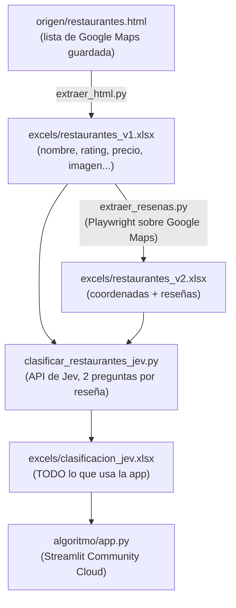
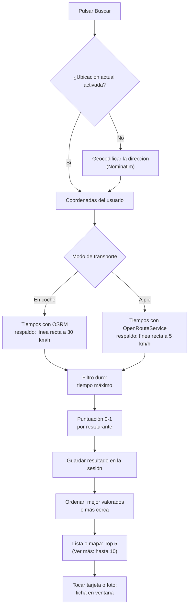
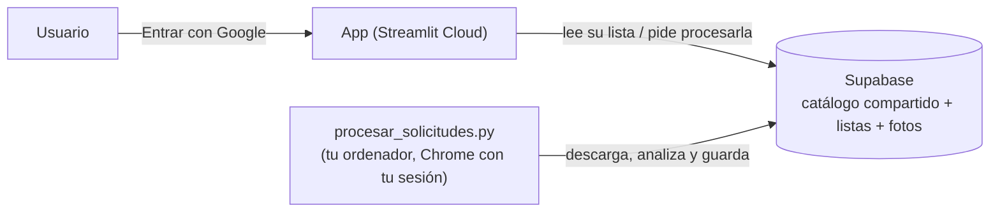

# ¿Dónde comemos hoy?

App web que recomienda, de una lista propia de restaurantes de Google Maps, cuáles encajan mejor con lo que os apetece hoy: presupuesto, tipo de cocina, plato, dónde estáis y cuánto queréis desplazaros (en coche o andando).

Funciona en dos partes independientes:

1. **Obtención de datos** (se ejecuta en local, de vez en cuando): convierte tu lista de Google Maps en un único excel con todo lo necesario, usando el modelo **Jev** (TypeSafe) para clasificar cada reseña.
2. **La app** (Streamlit, desplegada en Streamlit Community Cloud): lee ese excel, pregunta las preferencias y devuelve un ranking con mapa y fichas.

---

## Flujo general



Solo tres scripts, en este orden. Ya no existen `unificar_excels.py`, `analizar_resenas.py` ni `restaurantes_maestro.xlsx`: **Jev sustituye tanto al análisis de sentimiento (antes con `pysentimiento`) como a la unificación de los excels**, y escribe directamente el único archivo que necesita la app.

## Estructura del proyecto

```
proyecto/
├── requirements.txt              # SOLO dependencias de la app (Streamlit Cloud lee este)
├── requirements-dev.txt          # pytest, para los tests
├── .streamlit/
│   ├── config.toml               # tema de la app (claro y oscuro)
│   └── secrets.toml              # claves para probar en local (NO se sube a GitHub)
├── origen/
│   └── restaurantes.html         # HTML de tu lista de Google Maps
├── imagenes/                     # fotos de los restaurantes (las descarga extraer_html.py; se suben al repo)
├── excels/
│   ├── restaurantes_v1.xlsx
│   ├── restaurantes_v2.xlsx
│   └── clasificacion_jev.xlsx    # lo único que necesita la app
├── obtener_datos/
│   ├── requirements.txt          # dependencias de estos 3 scripts
│   ├── extraer_html.py
│   ├── extraer_resenas.py
│   ├── clasificar_restaurantes_jev.py
│   └── .cache/
│       └── cache_jev.jsonl       # resultados ya pagados a Jev (se sube a git: así no se repaga)
├── algoritmo/
│   └── app.py                    # la app web
└── tests/
    ├── test_humo.py              # tests de la app con AppTest
    └── referencia.json           # resultados esperados de 3 búsquedas fijas
```

Todos los scripts calculan sus rutas a partir de su propia ubicación (`Path(__file__)`), así que funcionan lanzados desde cualquier carpeta.

---

## Parte 1 · Obtención de datos

Se ejecuta en este orden, desde la carpeta `obtener_datos/`. Dependencias: `pip install -r obtener_datos/requirements.txt`.

| Paso | Script | Entrada | Salida | Qué hace |
|---|---|---|---|---|
| 1 | `extraer_html.py` | tu lista compartida (`--url`) u `origen/restaurantes.html` | `restaurantes_v1.xlsx` | Lee con BeautifulSoup cada restaurante de la lista: nombre, puntuación, nº de reseñas, rango de precios, tipo de cocina (el de Google, en bruto), **estado** (cerrado temporal/permanente) y **URL de la imagen**. Además descarga cada foto a `imagenes/` (solo las que aún no estén), porque las URLs de Google caducan en unas semanas. |
| 2 | `extraer_resenas.py` | `restaurantes_v1.xlsx` | `restaurantes_v2.xlsx` | Abre Google Maps con **Playwright** (un navegador real, gratis y sin clave), busca `"nombre, Madrid, España"`, entra en la ficha y lee hasta 30 reseñas por restaurante. Guarda una fila por reseña con el nombre, la URL de la ficha, las coordenadas (sacadas de esa URL) y un `Estado` (`OK`, `NO ENCONTRADO`, `SIN RESEÑAS`, `ERROR`). No trae dirección, teléfono ni web. |
| 3 | `clasificar_restaurantes_jev.py` | los dos anteriores | `clasificacion_jev.xlsx` | Asigna un ID a cada restaurante (por su posición en `restaurantes_v1.xlsx`), le añade la localización cruzando por nombre, y clasifica cada reseña con **Jev**. Es el único script de análisis; genera el excel final completo. |

### Cómo obtener la lista (paso 1)

**Automático (recomendado).** Comparte tu lista en Google Maps (abre la lista → *Compartir* → copiar enlace) y ejecuta:

```bash
python obtener_datos/extraer_html.py --url "https://maps.app.goo.gl/..."
```

Abre la lista con Playwright (se ve una ventana de Chrome; no la cierres), hace scroll hasta cargar todos los restaurantes y guarda la página en `origen/restaurantes.html`; después sigue como siempre. Si la página no trae ningún restaurante (enlace mal copiado, lista privada, Google ha cambiado algo), **no toca** `origen/restaurantes.html`: guarda lo descargado en `origen/restaurantes_descarga_fallida.html` para revisarlo y se para.

**A mano.** Abre tu lista en el navegador, haz scroll hasta que carguen **todos** los restaurantes, guarda el HTML como `origen/restaurantes.html` y ejecuta `python obtener_datos/extraer_html.py` sin `--url`.

### Requisitos del paso 2 (Playwright)

No necesita clave ni cuesta dinero, pero sí el navegador de Playwright:

```bash
pip install -r obtener_datos/requirements.txt
python -m playwright install chromium
```

Abre una ventana de Chrome visible y tarda varios minutos (espera entre restaurantes para no saturar a Google). Depende del HTML de Google Maps: si Google lo cambia, el script puede dejar de encontrar las reseñas.

### Cómo funciona el paso 3 (Jev)

Por cada reseña, **una sola llamada** a Jev responde dos preguntas a la vez (así el coste no se duplica):

- **Cocina**: una de las 16 categorías definidas en `CATEGORIAS`, dentro del propio script (o `no_se_sabe` si la reseña no habla de comida).
- **Sentimiento**: `Buena` / `Mala` / `Neutra`.

Por restaurante:
- **Cocina**: gana la más votada entre las reseñas informativas (todas menos `no_se_sabe`); hacen falta al menos 2 para que cuente, si no queda sin categoría. En empate, gana la primera categoría de la lista, y queda marcado.
- **Sentimiento**: recuento simple de reseñas Buenas/Malas/Neutras.
- **Platos destacados**: Jev nunca da esta información (su API solo devuelve la categoría elegida, probabilidades y una confianza). Se calculan en Python: por cada reseña, se busca si alguno de los platos de ejemplo escritos en `CATEGORIAS` (de cualquier categoría, no solo la ganadora) aparece literalmente en el texto, y se cuentan por sentimiento (`Platos mejor/peor valorados`).

Requisitos:

```powershell
pip install -r obtener_datos/requirements.txt
$env:TYPESAFE_API_KEY = "tu_clave"
```

La clave se saca de tu perfil en **app.typesafe.ai** (perfil → API key). Es gratuita, sin tarjeta, con acceso anticipado (el registro de cuentas nuevas puede estar pausado temporalmente).

Uso:

```bash
python clasificar_restaurantes_jev.py --probar "cachopo y cecina espectacular"   # prueba un texto suelto, sin tocar ningún excel
python clasificar_restaurantes_jev.py --limite 3                                # prueba con 3 restaurantes
python clasificar_restaurantes_jev.py                                           # todos
python clasificar_restaurantes_jev.py --reiniciar                               # ignora la caché y recalcula todo
```

**Caché**: cada resultado se guarda en `obtener_datos/.cache/cache_jev.jsonl` en cuanto se calcula. Si cortas la ejecución o la repites, no se paga otra vez por lo ya hecho. La clave de caché es el modelo, una huella de las categorías y las dos preguntas, y el texto de la reseña (no el restaurante: Jev solo ve el texto). Así, reordenar o añadir restaurantes no vuelve a cobrar nada; en cambio, si editas `CATEGORIAS` o `CATEGORIAS_SENTIMIENTO`, se recalcula todo.

**Coste**: Jev cobra 0,042 USD por millón de tokens de entrada (precio de lanzamiento, puede cambiar); la salida es gratis. Para unas 6.700 reseñas, cuenta con menos de 0,50 USD en total. Al terminar, el script imprime el gasto real de esa ejecución.

### Qué contiene `clasificacion_jev.xlsx`

| Hoja | Contenido |
|---|---|
| `Restaurantes` | Todo lo que usa la app: `ID`, Nombre, Puntuación, Nº Reseñas, Rango de precios, Tipo de cocina (Google), Imagen URL, Estado, Dirección, Latitud, Longitud, Teléfono, Web, Categoría (Jev), Categoría 2ª (Jev), % votos, Confianza, Reseñas leídas/informativas/con error, Reseñas buenas/malas/neutras, Platos mejor/peor valorados. |
| `Reseñas` | Una fila por reseña: categoría, sentimiento, probabilidades, confianza y los platos de ejemplo encontrados en el texto. |
| `Platos mencionados` | `ID_Restaurante`, Plato, Categoría del plato, Sentimiento, Fragmento — una fila por cada plato de ejemplo detectado. La usa la app para la búsqueda de "¿Algún plato concreto?". |
| `Configuración` | Modelo, huella de las categorías, fecha, coste, orígenes de los datos. |
| `Categorías` | Las 16 categorías de cocina + las 3 de sentimiento, con su descripción. |

Al ejecutarlo avisa por consola de cualquier restaurante con el **nombre repetido** en `restaurantes_v1.xlsx` (las reseñas de un nombre duplicado se cruzan todas con un solo ID, dejando al otro sin categoría), de reseñas que no se han podido asociar a ningún restaurante, y de restaurantes que se quedan sin `Dirección`.

> El ID es la posición de la fila en `restaurantes_v1.xlsx` (1…N). No es permanente entre versiones: si cambias el orden o el contenido de ese excel, regenera `clasificacion_jev.xlsx` entero.

---

## Parte 2 · La app

Archivo: `algoritmo/app.py`. Al arrancar carga `excels/clasificacion_jev.xlsx` (hojas `Restaurantes` y `Platos mencionados`).

### Lo que ve quien la usa

La interfaz está pensada primero para el móvil (tema en `.streamlit/config.toml`: crema y terracota, Fraunces + Inter, modo claro y oscuro). Tiene dos vistas en la misma página:

**Buscador**, ordenado por lo que más descarta:
1. **Desde dónde salís**: caja con sugerencias mientras escribes (Photon, solo Comunidad de Madrid), o el botón **"Usar mi ubicación"** (el navegador pide permiso; requiere HTTPS, que Streamlit Cloud ya tiene). Con la ubicación activa la caja se desactiva; "Quitar" vuelve a la dirección escrita.
2. **Cómo vais** (coche / a pie) y **tiempo máximo** (5-60 min).
3. **Cocina** (o "Cualquiera"): categorías de Jev.
4. **Presupuesto** por persona (rango 0-100 €; 100 = sin tope).
5. **Más opciones**: plato concreto (opcional), busca en la hoja `Platos mencionados`.
6. **Buscar restaurantes**: botón fijo abajo, al alcance del pulgar.

**Resultados**: barra con "← Cambiar" (vuelve al buscador con todo lo escrito), **Lista | Mapa** y un resumen de lo pedido; debajo, **Mejor valorados | Más cerca** (reordena sin repetir la búsqueda) y las tarjetas compactas. Al tocar una tarjeta o una foto del mapa se abre la **ficha** en una ventana encima.

### Qué pasa al buscar



**Filtros duros.** Solo pasan los restaurantes que cumplen todo lo pedido; si no hay suficientes, no se rellena con otros:
- tiempo de desplazamiento menor o igual al máximo (los que no tienen coordenadas quedan fuera);
- cocina elegida como principal o como secundaria con peso (fuera los de otra cocina y los no clasificados);
- rango de precio que se cruce con el presupuesto (los que no tienen precio pasan, porque no se puede saber);
- si pediste plato, menciones positivas de ese plato en las reseñas.

**Puntuación.** Cada restaurante recibe un score entre 0 y 1 combinando cinco componentes. Los pesos están al principio de `app.py` (`PESO_*`) y se pueden cambiar:

| Componente | Peso | Cómo se calcula |
|---|---|---|
| Precio | 0.15 | Solapamiento entre tu rango de presupuesto y el rango de precios del restaurante (0.5 si alguno no tiene rango). |
| Cocina | 0.30 | Ver más abajo, "Cómo puntúa la cocina". |
| Plato | 0.20 | Menciones del plato pedido en `Platos mencionados`: proporción de menciones positivas más un pequeño bonus por volumen. 0 si no pediste plato o no aparece. |
| Calidad | 0.30 | 60 % puntuación de Google (sobre 5) + 40 % proporción de reseñas "Buenas" (de Jev). Si no hay reseñas analizadas, solo la puntuación de Google. |
| Nº de reseñas | 0.05 | Volumen de reseñas relativo al restaurante con más reseñas (señal de confianza). |

**Cómo puntúa la cocina.** El desplegable ofrece las categorías de Jev, pero no todos los restaurantes tienen una (hace falta un mínimo de reseñas informativas). Por eso el encaje se calcula así:
- **1.0** si es la categoría principal del restaurante (o hay empate con la segunda).
- **0.6** si es la categoría secundaria, y esta tiene al menos el 25 % de los votos.
- **0.0** si tiene otra categoría distinta.
- **Sin categoría de Jev**: se compara la elegida contra el `Tipo de cocina` de Google, por **raíz de palabra** (no por frase completa, porque "Asiática (otras)" casi nunca aparece tal cual en el texto de Google, pero "asiat" sí encaja con "Asiática, Fusión"). Si coincide, 1.0; si no, 0.3 (ni sí ni no, para no descartarlo del todo).

**Resultado.** Se muestran 5; **Ver más** amplía a 10 (y no aparece si no hay más que encajen). Si hay menos de 5, se avisa ("Solo hay 3 que encajan"). Si no hay ninguno, se ofrecen atajos: ampliar el tiempo, cualquier cocina o quitar el plato.
- **Tarjeta** (componente propio, horizontal): foto pequeña, nombre, cocina, precio, nota y minutos. Los cerrados temporal o permanentemente salen atenuados y con etiqueta.
- **Ficha** (`st.dialog`): foto grande, cocina, precio, nota, tiempo, dirección, información del plato pedido, platos destacados, **Cómo llegar** (ruta en Google Maps) y enlaces a Instagram, TikTok y Google (búsquedas de Google limitadas a cada red, porque ninguna de las dos permite buscar sin iniciar sesión). El score no se muestra.

### El mapa

- Componente propio (Streamlit Components v2) con **Leaflet**. Cada restaurante es su **foto redonda** con el número de posición (el mismo que en la lista; el nº 1 en dorado). Tu ubicación es el punto azul.
- **Mapa base:** OpenFreeMap "Positron" (vectorial, sin clave), dibujado con MapLibre GL. Si el navegador no puede (sin WebGL, sin acceso a OpenFreeMap, tarda más de 12 s), cae automáticamente a **OpenStreetMap**.
- **Tocar una foto** resalta el pin y abre su ficha; tocar en un hueco quita la selección. El zoom que pongas se conserva. Ocupa el 60 % de la altura de la pantalla.
- Si no hay resultados, el mapa muestra solo tu ubicación: sirve para comprobar que la app te ha situado donde esperabas.

### Estado de la sesión

Los resultados se guardan en `st.session_state` para que "Ver más", cambiar el orden o la vista, o tocar el mapa no repitan toda la búsqueda. Claves principales: `vista` (buscador/resultados), `resultado`, `num_mostrados`, `restaurante_seleccionado`, `ficha_abrir`, `ubicacion_actual`. El formulario se dibuja siempre (en resultados solo se oculta con CSS) para no perder lo escrito.

---

## Configuración y claves

| Clave | Dónde | Para qué | Obligatoria |
|---|---|---|---|
| `TYPESAFE_API_KEY` | Variable de entorno (local) | Clasificar con Jev (paso 3) | Solo al ejecutar el paso 3 |
| `ORS_API_KEY` | Secretos de Streamlit | Tiempos reales andando (OpenRouteService, plan gratuito) | No: sin ella, "a pie" estima por línea recta a 5 km/h y avisa |

Secretos en local: fichero `.streamlit/secrets.toml` en la raíz del proyecto:

```toml
ORS_API_KEY = "tu-clave"
```

Secretos en Streamlit Cloud: **Manage app → Settings → Secrets**, misma línea. `.streamlit/secrets.toml` ya está en `.gitignore`: no se sube nunca.

---

## Ejecutar y desplegar

**En local**

```bash
pip install -r requirements.txt
streamlit run algoritmo/app.py
```

**Tests** (cargan la app con AppTest y lanzan búsquedas reales, ~40 s):

```bash
pip install -r requirements-dev.txt
pytest tests/
```

Si cambias a propósito los datos o la puntuación, los resultados esperados cambian: regenera la referencia con `REGENERAR_REFERENCIA=1 pytest tests/test_humo.py`.

**Desplegar en Streamlit Community Cloud**

1. Sube el proyecto a un repositorio de GitHub (`excels/clasificacion_jev.xlsx` incluido; puede ser privado).
2. En share.streamlit.io: *New app* → repositorio y rama → **Main file path: `algoritmo/app.py`**.
3. El `requirements.txt` de la **raíz** debe contener solo lo que necesita la app:

```
streamlit
pandas
openpyxl
geopy
requests
pillow
```

   Las dependencias de la obtención de datos van en `obtener_datos/requirements.txt`; si acaban en el de la raíz, el despliegue se vuelve lento o falla.
4. La ruta del *Main file path* no se puede editar después: para cambiarla hay que borrar la app y volver a crearla (se puede reutilizar el subdominio).
5. Tras subir cambios se redespliega solo (o *Reboot app* en *Manage app*). Como `cargar_datos()` se cachea en memoria, si solo cambias el excel y no el código, a veces hace falta *Reboot app* para que la app se entere. Si la página sale en blanco justo después de un despliegue, recárgala.

**Actualizar los datos:** vuelve a ejecutar `clasificar_restaurantes_jev.py` (basta con este si `restaurantes_v1.xlsx` y `restaurantes_v2.xlsx` no han cambiado), sube el nuevo `clasificacion_jev.xlsx` y redespliega.

---

## Modo multiusuario (login con Google y una lista por persona)

Sin configurar nada, la app funciona como siempre (**modo local**: una sola lista, la de `excels/`). Con las claves de abajo en los secrets pasa a **modo multiusuario**: cada persona entra con su cuenta de Google, pega el enlace de su lista en **"Mi lista"** y ve solo sus restaurantes.



- **Catálogo compartido:** si dos personas tienen el mismo restaurante, se analiza una sola vez (Jev no cobra dos veces).
- **El procesado se hace en tu ordenador**, porque necesita Chrome visible y tu sesión de Google (es la que enseña los precios). Las listas pedidas quedan "pendientes" hasta que ejecutas el procesador.
- **Seguridad:** la clave de servicio de Supabase solo está en el servidor de Streamlit y en tu ordenador; las tablas no se pueden leer con la clave pública. El procesador solo acepta enlaces de listas de Google Maps, porque los abre con tu sesión.

### Puesta en marcha (una vez)

1. **Supabase** (gratis): crea un proyecto en supabase.com → *SQL Editor* → abre el archivo `supabase/esquema.sql` del proyecto, copia **todo su contenido** (no el nombre del archivo) y pégalo en el editor → *Run*. Debe responder "Success. No rows returned" y crear las tablas `restaurantes`, `listas` y `lista_restaurantes` (*Table Editor*) y el bucket público `fotos` (*Storage*). En *Project Settings → API* copia la **URL** y la clave **`service_role`** (no la `anon`).
2. **Login con Google** (gratis): en console.cloud.google.com → *APIs y servicios → Credenciales → Crear credenciales → ID de cliente de OAuth* → tipo *Aplicación web*. En *URIs de redirección autorizados* añade `https://TU-APP.streamlit.app/oauth2callback` y `http://localhost:8501/oauth2callback`. Copia el ID y el secreto del cliente. (Si te pide configurar la *pantalla de consentimiento*, tipo *Externo* y añade como usuarios de prueba los correos que vayan a entrar.)
3. **Secrets** (`.streamlit/secrets.toml` en local y *Manage app → Settings → Secrets* en Streamlit Cloud):

   ```toml
   ORS_API_KEY = "..."                       # como antes

   usuarios_permitidos = ["tu@gmail.com", "amiga@gmail.com"]   # opcional: vacío = cualquiera puede entrar

   [supabase]
   url = "https://xxxx.supabase.co"
   clave_servicio = "eyJ..."                 # la service_role

   [auth]
   redirect_uri = "https://TU-APP.streamlit.app/oauth2callback"   # en local: http://localhost:8501/oauth2callback
   cookie_secret = "una cadena larga y aleatoria"
   [auth.google]
   client_id = "....apps.googleusercontent.com"
   client_secret = "..."
   server_metadata_url = "https://accounts.google.com/.well-known/openid-configuration"
   ```

   Como pagas tú Jev, conviene rellenar `usuarios_permitidos` con las 20-25 personas.
4. **Sube tu lista actual** a Supabase como la de tu cuenta:

   ```bash
   python obtener_datos/migrar_a_supabase.py --email tu@gmail.com --url "https://maps.app.goo.gl/..."
   ```

> **Si ya habías ejecutado `esquema.sql` antes de que existiera el menú de usuario**, ejecuta también `supabase/002_perfiles.sql` (mismo procedimiento: copiar su contenido en el *SQL Editor* → *Run*). Crea la tabla `perfiles`, donde se guarda el nombre que cada usuario elige en **Datos personales**. Sin ella la app funciona, pero usa el nombre de Google y no deja guardar cambios.
>
> **Y para las preferencias del Perfil**, ejecuta `supabase/003_preferencias.sql` (añade la columna `preferencias` a `perfiles`). Sin ella todo funciona, pero *Guardar preferencias* da error.
>
> **Y para amigos y «He ido»**, ejecuta `supabase/004_amigos.sql` (columna `alias` en `perfiles` y tablas `amistades` y `visitas`).
>
> **Y para las valoraciones** (medias estrellas y comentario, una por restaurante), ejecuta después `supabase/005_valoraciones.sql`.
>
> **Y para las fotos de los amigos**, ejecuta `supabase/006_fotos_perfil.sql` (la app guarda sola la foto de Google de cada uno al entrar; sin la columna, se ven sus iniciales).
>
> **Y para poder subir una foto de perfil propia**, ejecuta después `supabase/007_foto_propia.sql` (permite guardar, además de las de Google, las fotos subidas a la app).
>
> **Y para la Eatlist** (los restaurantes a los que quieres ir, en tu orden), ejecuta `supabase/008_eatlist.sql`.
>
> **Y para Explorar** (cualquier restaurante, aunque no esté en ninguna lista), ejecuta `supabase/009_lugares.sql` y después importa una zona (gratis: datos abiertos de [Overture Maps](https://overturemaps.org), sin clave; necesita `pip install duckdb`):
>
> ```bash
> python obtener_datos/importar_overture.py --zona madrid      # ~38.000 sitios, ~1 min; también: espana, canarias
> python obtener_datos/importar_overture.py --caja -3.80 40.35 -3.60 40.50   # o una caja: oeste sur este norte
> ```
>
> Al importar se enlazan solos con los restaurantes que ya estaban en el catálogo (mismo sitio, a menos de 150 m, y nombre parecido), que salen ya como *Analizado*. Volver a importar actualiza los datos sin perder lo pedido ni lo analizado.

### Cuentas con correo y contraseña

Además de Google, se puede crear una cuenta con nombre, correo y contraseña. Lo gestiona **Supabase Auth** (el mismo proyecto): guarda las contraseñas cifradas, manda el correo de confirmación y el código para recuperar la contraseña. La app identifica a cada persona por su **correo**, así que una cuenta con contraseña y una de Google con el mismo correo son la misma (misma lista y amigos). Por eso **es obligatorio confirmar el correo**: si en Supabase se desactiva *Confirm email*, la app oculta las cuentas con contraseña.

Una vez, en el panel de Supabase:

1. **Authentication → Sign In / Providers → Email**: activado, con *Confirm email* activado (viene así por defecto).
2. **Authentication → URL Configuration → Site URL**: la URL de la app (p. ej. `https://tuapp.streamlit.app`). Es a donde lleva el enlace del correo de confirmación.
3. **Envío de correos (imprescindible para usuarios reales):** el servidor de correo que trae Supabase **solo envía a los miembros de tu equipo** y muy pocos por hora. Configura uno propio en **Project Settings → Authentication → SMTP Settings** (p. ej. [Resend](https://resend.com) o Brevo, ambos con plan gratis).
4. **Authentication → Email Templates → Reset Password**: cambia el cuerpo para que incluya el código, p. ej. `Tu código para cambiar la contraseña es: {{ .Token }}` (la app pide ese código; no usa el enlace).

La sesión se guarda en una cookie del navegador durante 30 días (solo el token de renovación de Supabase), para no pedir la contraseña cada vez. *Cerrar sesión* la borra y la cierra también en Supabase.

### Secciones (barra de abajo)

- **Inicio**: una idea para hoy: «¿Te apetece cachopo? Te gustará Casa Pepe», con la ficha del sitio. Elige al azar un plato que las reseñas de tu lista elogian (al menos 2 menciones buenas en un mismo sitio abierto) y el sitio donde más lo elogian. *Otra idea* cambia de plato; *Más sitios con…* lo busca en Comer hoy. Debajo, **Tus amigos han ido a**: tarjetas pequeñas que se deslizan hacia la derecha con los sitios que tus amigos han marcado con *He ido* en las **dos últimas semanas** (quién, cuándo, el restaurante, su nota y su comentario).
- **Explorar** (solo con cuentas): cualquier restaurante, bar o cafetería de las zonas importadas, por nombre y/o cerca de tu ubicación (del más cercano al más lejano). Los **analizados** abren su ficha completa (nota, lo que destacan, eatlist, *He ido*…); los demás enseñan lo básico (categoría, dirección, Google Maps, web y teléfono) y un botón **Analizar este restaurante**, que lo pone en la cola del procesador. Lo que has pedido sale en *Has pedido analizar*, con su estado.
- **Comer hoy**: el buscador de siempre (desde dónde, tiempo, cocina, presupuesto y plato).
- **Buscar** (antes «Mi lista»): arriba, **Restaurantes** o **Personas**. *Restaurantes*: todos los de tu lista, con buscador por nombre, filtros (cocina, presupuesto, nota mínima, plato, ocultar cerrados) y orden. *Personas*: buscar gente registrada por su nombre o @usuario y añadirla como amiga (aquí también se elige tu @usuario si aún no lo tienes).
- **Perfil** (el icono es tu foto): arriba, estilo Instagram, tu foto (tócala para abrir **Ajustes de usuario**: cambiar o quitar tu foto, *Datos personales*, *Tus listas* y *Preferencias*), nombre, @usuario y tres cifras que llevan a su sitio: **idos** (Diario), **en tu lista** (Mi lista) y **amigos**. Debajo, tres pestañas:
  - **Perfil**: *Tus datos* (tu cocina favorita, cuánto de tu lista has probado, sitios este mes, tu nota media, tu favorito y el precio medio) y *Cerrar sesión*.
  - Al tocar **amigos** en la cabecera: su listado (solicitudes, cifras y tus amigos uno debajo de otro; «Ver» abre su mini perfil).
  - **Diario**: los restaurantes a los que has ido, por meses, con el día, la foto y tu nota (y *Ver en formato lista*, que lleva a Mi lista con solo esos).
  - **Eatlist**: los que quieres probar, en tu orden. Se añaden desde la ficha de cada restaurante (botón «Añadir a mi eatlist»), que abre «Tu eatlist» en una ventanita encima de la propia ficha para elegir el puesto: al cambiar el número se ve, sin guardar todavía, quién queda justo antes y justo después. Al marcar «He ido», sale de la eatlist.
- **Quitar de mi lista** (en la ficha de los restaurantes de tu lista, con confirmación): solo deja de estar en *tu* lista; el restaurante no se borra de la app (sigue en las listas de los demás, en «Todos los restaurantes» y en tus valoraciones). Si vuelves a sincronizar y sigue en tu lista de Google Maps, volverá.
- **Amigos**: eliges un **@usuario** (3-20 letras sin tildes, números, `_` o `.`) y buscas a otros en **Buscar → Personas** por su @usuario o nombre. La amistad es con **solicitud**: el otro la acepta o la rechaza; las pendientes salen en una tarjeta de color en el listado de amigos (al tocar «amigos» en la cabecera del Perfil) y con un globito con el número sobre tu foto en la barra de abajo. Al tocar «Ver» en un amigo se abre su **mini perfil**: % de gustos en común, nota media, a cuántos sitios ha ido, cocina favorita, sus últimas valoraciones y los restaurantes en común. Los correos no se enseñan nunca.
  - *Afinidad*: lo parecidas que son las cocinas de vuestras listas (60 %) y, si habéis valorado al menos 2 sitios en común, lo parecidas que son vuestras notas (40 %).
- **He ido** (arriba en la ficha de cualquier restaurante): nota opcional de 0,5 a 5 estrellas (medias estrellas) y «lo que más te gustó». Una valoración por restaurante: se puede cambiar o quitar, y el recuadro sale en verde si ya has ido. Lo ven tus amigos en su Inicio; en las listas, los sitios a los que has ido llevan «✓ Has ido», y en tu Perfil está **Los restaurantes a los que has ido**.

### Día a día
  
- Cada usuario entra, abre **"Mi lista de Google Maps"**, pega el enlace de su lista (en Google Maps: la lista → *Compartir* → copiar enlace) y pulsa **Guardar y procesar**. Queda *pendiente*.
- Tú, de vez en cuando, en tu ordenador (con `TYPESAFE_API_KEY` definida):

  ```bash
  python obtener_datos/procesar_solicitudes.py           # procesa las pendientes
  python obtener_datos/procesar_solicitudes.py --todas   # refresca todas (precios, cierres, restaurantes nuevos)
  python obtener_datos/procesar_solicitudes.py --vigilar # no termina: cada 10 min procesa las pendientes que haya
  python obtener_datos/procesar_solicitudes.py --pestanas 1   # una pestaña (por defecto 3), si Google pone pegas
  ```

  Las reseñas se sacan **con tu sesión de Google** (sin sesión, Google Maps enseña solo ~5 por sitio; con ella, las 30) y en **3 pestañas a la vez**: unos 20 s por restaurante nuevo. Al terminar cada lista se imprimen los tiempos de cada paso.

  **Importante:** lo pedido (listas y *Analizar* de Explorar) **solo se procesa mientras el procesador está en marcha** en tu ordenador: necesita Chrome y tu sesión de Google, y eso no se puede llevar a la nube (lo probamos en GitHub Actions: Chrome ata la sesión a su perfil y Google anula la que se usa desde un servidor). Por eso arranca solo con Windows; ver *Procesador automático* más abajo.

  Si alguien pega **una lista que otra persona ya tiene procesada**, se copia al momento, sin esperar al procesador.

- **Explorar → Analizar**: el mismo procesador (también con `--vigilar`) analiza después de las listas los restaurantes pedidos, primero los que más gente ha pedido. Si ya estaba en el catálogo (mismo nombre y a menos de 300 m) solo se enlaza, sin pasar por Jev. Si no, lo busca en Google Maps **por sus coordenadas**, lee de su ficha lo que en una lista viene en la lista (nota, nº de reseñas, precio, cocina, foto, si está cerrado; precio y nº de reseñas solo salen con tu sesión de Google), saca sus reseñas y lo clasifica con Jev como siempre. Si Google no lo encuentra, queda como *No se pudo analizar* (se puede volver a pedir).
- **Tus listas** (en el Perfil): estado de la sincronización, enlace de la lista y botón *Guardar y sincronizar*.
- **Buscar en: Mi lista / Todos los restaurantes**: la segunda opción busca entre todos los restaurantes de la base de datos (los de todas las listas).

  La primera vez se abre Chrome para que inicies sesión en Google (queda guardada en `origen/perfil_chrome/`, fuera de git). Solo se analizan con Jev los restaurantes que no estaban en el catálogo. Si una lista falla, el usuario lo ve en "Mi lista" con el motivo.
- La app tarda hasta 5 minutos en mostrar una lista recién procesada (caché).

### Procesador automático (en tu ordenador) y sitios al día

- **Análisis automático:** una tarea de Windows arranca el procesador al iniciar sesión, oculto y en modo `--vigilar 2 --sin-ventana`: cada 2 minutos mira si hay algo pedido (listas o *Analizar este restaurante*) y lo analiza con tu Chrome y tu sesión de Google, **sin abrir ninguna ventana** (Chrome trabaja por detrás). Si la sesión de Google se cierra, lo pedido queda con error y hay que volver a iniciarla una vez con `python obtener_datos/procesar_solicitudes.py` (sin `--sin-ventana`). Lo pedido está listo en unos minutos **mientras el ordenador esté encendido**; si está apagado, se hace al encenderlo. Lo que va haciendo queda en `origen/procesador.log`. Si se cae la red, lo vuelve a intentar en la siguiente vuelta. Para crear la tarea (una vez, en PowerShell desde la carpeta del proyecto, con `TYPESAFE_API_KEY` definida como variable de entorno de usuario):

  ```powershell
  $accion = New-ScheduledTaskAction -Execute "powershell.exe" -WorkingDirectory (Get-Location) -Argument '-NoProfile -WindowStyle Hidden -Command "$env:PYTHONIOENCODING=''utf-8''; python obtener_datos\procesar_solicitudes.py --vigilar 2 --sin-ventana *>> origen\procesador.log"'
  $ajustes = New-ScheduledTaskSettingsSet -AllowStartIfOnBatteries -DontStopIfGoingOnBatteries -ExecutionTimeLimit 0 -RestartCount 3 -RestartInterval (New-TimeSpan -Minutes 5)
  Register-ScheduledTask -TaskName "restAIrantes procesador" -Trigger (New-ScheduledTaskTrigger -AtLogOn -User $env:USERNAME) -Action $accion -Settings $ajustes
  ```

  Para pararlo: *Programador de tareas → restAIrantes procesador → Finalizar* (o *Deshabilitar* para que no arranque más).
- **Los lunes a las 4:00** (5:00 en horario de verano), GitHub Actions (`.github/workflows/procesador.yml`) **comprueba durante 5 horas si los sitios de Explorar siguen abiertos** (`obtener_datos/verificar_lugares.py`: abre su ficha de Google Maps y, si dice *Cerrado permanentemente* y es el mismo sitio, lo oculta). No necesita sesión de Google ni tu ordenador. Unos 6.000 sitios por semana: primero los nunca comprobados y después los comprobados hace más de 30 días. Necesita los secretos del repositorio `SUPABASE_URL` y `SUPABASE_CLAVE_SERVICIO` (*Settings → Secrets and variables → Actions*).
- **Cada mes** (`.github/workflows/importar_overture.yml`) vuelve a importar las zonas de Explorar con la versión nueva de Overture: entran los sitios nuevos y se ocultan los que Overture ya da por cerrados o ha dejado de publicar (salvo los pedidos o analizados). Las zonas, en la variable del repositorio `ZONAS_OVERTURE` (p. ej. `madrid canarias`); por defecto, `madrid`.
- Al analizar un sitio que Google da por cerrado, se oculta sin sacar reseñas ni pasar por Jev. Y en la ficha básica de Explorar cualquiera puede pulsar **¿Ha cerrado? Avísanos** y deja de salir al momento.
- Ejecuta una vez en Supabase `supabase/010_lugares_al_dia.sql` (estado *cerrado* y fecha de la última comprobación).

## Servicios externos

| Servicio | Uso | Clave | Nota |
|---|---|---|---|
| Photon (komoot) | Sugerencias mientras escribes la dirección | No | Lo llama el navegador directamente; solo Comunidad de Madrid. |
| Nominatim (OpenStreetMap) | Convertir la dirección escrita en coordenadas (si no eliges sugerencia) | No | Limitado a la Comunidad de Madrid; algunos números de portal no los tiene. |
| OSRM (servidor demo) | Tiempos en coche | No | Servicio compartido sin garantías; si falla se estima por línea recta a 30 km/h. |
| OpenRouteService | Tiempos andando | Sí (gratuita) | Su matriz a pie falla a veces con un error interno; en ese caso se estima por línea recta a 5 km/h. |
| OpenFreeMap / OpenStreetMap | Mapa base | No | Se cargan junto con Leaflet y MapLibre desde jsDelivr. |
| Google Maps | Fotos (paso 1) y reseñas con coordenadas (paso 2) | No | Las URL de las fotos caducan en semanas: por eso se descargan a `imagenes/`. |
| Google (búsquedas) | Enlaces de la ficha: nombre, Instagram, TikTok y "Cómo llegar" | No | |
| **Jev (TypeSafe)** | Clasificar cocina y sentimiento de cada reseña | Sí (gratuita, acceso anticipado) | Modelo en fase temprana; el registro de cuentas nuevas puede estar pausado. Solo en el paso 3. |

---

## Limitaciones conocidas

- **Restaurantes cerrados:** salen en los resultados, atenuados y con la etiqueta "Cerrado temporalmente/permanentemente" (columna `Estado`).
- **Cobertura de platos:** la búsqueda de "¿Algún plato concreto?" y los "platos destacados" solo reconocen los platos escritos como ejemplo dentro de `CATEGORIAS` (bastantes, pero no genéricos como "pan" o "postre": esos no ayudan a distinguir una cocina y por eso no están ahí).
- **Enlaces de Google del nombre:** buscan siempre "nombre + Madrid". Para restaurantes de otros municipios (Majadahonda, Patones...) conviene usar la dirección real; pendiente.
- **Geocodificación:** la búsqueda está limitada a la Comunidad de Madrid, pero algunos números de portal no están en OpenStreetMap y se toma otro punto de la misma calle. Elige una sugerencia de la lista o comprueba "Te he situado en" encima de los resultados.
- **Jev es un modelo en acceso anticipado:** su documentación indica que rinde mejor en inglés; en español conviene revisar de vez en cuando la hoja `Reseñas` para detectar clasificaciones raras. Su comportamiento, precios y límites pueden cambiar sin aviso.
- **Nombres duplicados:** si un restaurante aparece dos veces en `restaurantes_v1.xlsx`, todas sus reseñas se cruzan con un solo ID y el otro se queda sin categoría (el script avisa de esto por consola).
- **IDs:** cambian si cambia el orden de `restaurantes_v1.xlsx`. No afecta a la caché de Jev (su clave no lleva el ID) ni a la app (los IDs solo viven dentro de una búsqueda).

---

## Problemas frecuentes

| Síntoma | Causa y solución |
|---|---|
| `ModuleNotFoundError: No module named 'bs4'` | Falta instalar las dependencias de `obtener_datos/`: `pip install -r obtener_datos/requirements.txt`. |
| `Executable doesn't exist` al ejecutar `extraer_resenas.py` | Falta el navegador de Playwright: `python -m playwright install chromium`. |
| `No encuentro la variable de entorno TYPESAFE_API_KEY` | Defínela en la misma ventana de terminal donde ejecutas `clasificar_restaurantes_jev.py`. La clave sale de tu perfil en app.typesafe.ai. |
| `ERROR: no hay ninguna reseña que clasificar` | El script imprime un diagnóstico (filas leídas, con texto, cruzadas por nombre). Suele ser que `restaurantes_v1.xlsx` se regeneró con nombres distintos a los de `restaurantes_v2.xlsx`: compara los nombres de ejemplo que muestra el error. |
| Aviso de "nombre repetido" en `restaurantes_v1.xlsx` | Ese restaurante aparece dos veces; borra la fila duplicada y vuelve a ejecutar `clasificar_restaurantes_jev.py`. |
| Aviso amarillo sobre `ORS_API_KEY` | No hay clave de OpenRouteService en los secretos: el modo "a pie" estima por línea recta. Añádela para tiempos reales. |
| "Nada por aquí" | Usa los atajos (ampliar el tiempo, cualquier cocina, sin plato) o mira "Te he situado en": quizá la dirección se ha geocodificado en otro sitio. |
| El botón "Usar mi ubicación" no funciona | El navegador debe tener permitida la ubicación para la página (icono del candado) y la página debe servirse por HTTPS o `localhost`. |
| El mapa muestra OpenStreetMap en vez de Positron | El mapa vectorial no se pudo cargar (sin WebGL o sin acceso a OpenFreeMap): es el respaldo automático, no un error. |
| Página en blanco, error 404 en consola, o la app no refleja un excel nuevo | Recarga la página; si no, dale a "Reboot app" desde "Manage app" en Streamlit Cloud. |